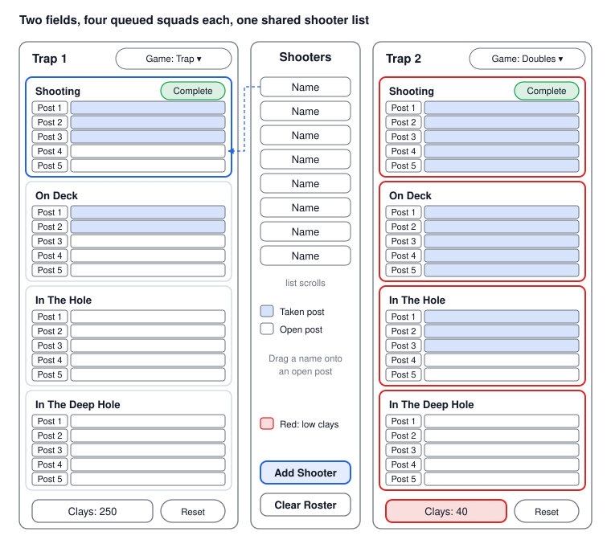
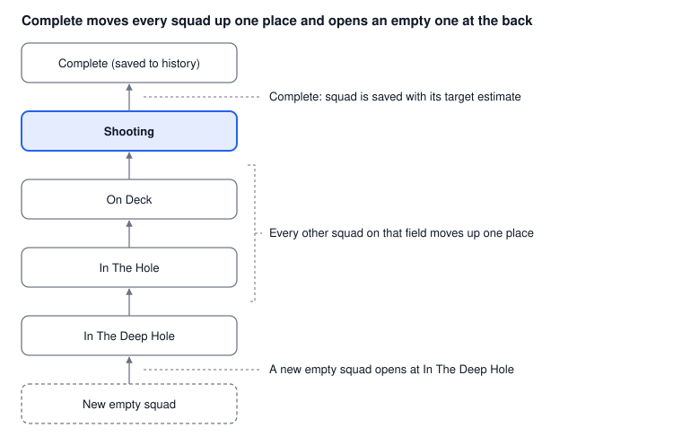

# Trap Squad Tracker: iPad App Design Document

Oct 21, 2026 · Draft v0.3

## 1. Overview and goals

Trap Squad Tracker is an iPad web app, installed to the Home Screen and fully usable offline, that lets club members and staff sign up for squads on two trap fields by dragging shooter names into squad posts, instead of using paper. Each field shows four squads in order: Shooting, On Deck, In The Hole and In The Deep Hole. When a squad finishes, one tap on Complete moves everyone up, and the app estimates how many clay targets that squad used and how many clays are left in the thrower.

Completed squads are kept as a history that can be reviewed for the day and exported to CSV.

**Goals for v1**

- Show the live squad queue for Trap 1 and Trap 2 on one iPad screen.
- Build a squad by dragging a name from the shared shooter list into an open post.
- Advance the queue with one "Complete" action per field.
- Estimate targets thrown per squad from the game and the number of shooters, and track the clays left in each thrower.

**Success looks like**

- A squad of five can be built in under 15 seconds.
- Members and staff can run a full shoot day without ever needing paper.
- A wrong placement can be fixed in one gesture.

## 2. Users and usage context

The primary users are club members, who sign themselves and their friends up at a single iPad left on the registration table. Staff use the same screen to call squads to the line. There is no login, so everyone sees and edits the same board.

| Factor | Design implication |
| --- | --- |
| Outdoors, bright sun | High-contrast colors, large type, no reliance on subtle shading |
| Busy, one hand often free | Big touch targets, drag and tap both work for every action |
| Interruptions | Every action is instantly saved and can be undone |
| Spotty connectivity | Fully offline; no account or network needed to run a shoot |
| iPad in landscape on a stand | Landscape is the primary layout; portrait is secondary |
| Mixed experience with apps | One screen, no deep menus, plain labels; no login, so a first-time member can use it at once |

## 3. Scope

v1 covers one club, one iPad and two fields; everything else waits.

| In v1 | Not in v1 (later) |
| --- | --- |
| Two trap fields on one screen | More than two fields |
| Four squads per field, one to five shooters each (posts 1 to 5) | Configurable squad size or post count |
| Shared shooter list with Add Shooter and Clear Roster; the list persists until cleared | Member database, dues, accounts |
| Drag and drop into open posts | Score entry per target |
| Mark squad complete, queue advances, day history with CSV export | Results, leaderboards, handicaps |
| Estimated targets per squad and per day, clays loaded per field with a reset on refill | Inventory and billing of clay targets |
| Installable web app that works offline, with data stored on the iPad | Multi-iPad sync, shooter-facing display |

## 4. Screen layout

One landscape screen holds both fields with the shooter list between them, as in your sketch. The game labels, filled posts and clay counts shown are sample states only.



- **Field header:** the field name and a game selector (Trap, Continental, Doubles) that carries over to the next squad. At the bottom of the panel, the clays loaded in the thrower with a Reset button that restores the full-machine count in one tap, with no dialog; the count and every squad on that field turn red when the clays run too low, until Reset is selected.
- **Squad order, top to bottom:** Shooting, On Deck, In The Hole, In The Deep Hole.
- **Squad:** five posts listed top to bottom like a scoresheet, Post 1 to Post 5, each holding one name. A squad can run with one to five shooters. A taken post is filled; an open post is empty.
- **Shooting squad:** highlighted, and carries the green Complete button from your sketch.
- **Center list:** all shooters, shared by both fields. A name stays in the list after it is placed. Add Shooter and Clear Roster sit at the bottom.

## 5. Data model

Five entities are enough for v1. A shooter can be in several squads at once, on either field, but only once per squad, and a squad belongs to exactly one field.

| Entity | Key fields | Rules |
| --- | --- | --- |
| Field | id, name (Trap 1, Trap 2), current game, clays loaded in the thrower | Exactly two in v1; owns an ordered queue of squads; the game carries over to the next squad; the clay count can be reset at any time, in one tap, to the full-machine count set in Settings |
| Squad | id, field, queue position (0 to 3), game, status, start time, end time, estimated targets | Position 0 is Shooting, 1 On Deck, 2 In The Hole, 3 In The Deep Hole; holds one to five shooters; the estimate uses the field's game when the squad completes |
| Post slot | squad, post number (1 to 5), shooter (optional) | One shooter per slot; a slot with a shooter is full and rejects drops; the same shooter cannot take two posts in one squad |
| Shooter | id, display name, active flag | Always in the center list; can be placed in many squads, but not twice in the same squad |
| Game | name, targets per shooter, notes | Trap, Continental, Doubles; editable table, see section 8 |

**Squad status** is one of Queued, Shooting or Complete. Completed squads are kept as history (field, game, shooters, estimated targets, time) so the day's totals can be reported and exported to CSV. Clear Roster erases this history along with the shooter list, and Clear history in the History window erases it alone after one confirmation; both can be undone right afterwards.

## 6. Interaction design

Dragging a name into a post is the main gesture, and every drag has a tap equivalent so it still works with gloves or a shaky hand.

| Action | Gesture | Rule |
| --- | --- | --- |
| Assign a shooter | Drag a name from the center list onto a post | Only an open post accepts the drop; a full post shows no highlight and the name springs back. After placement the name stays in the center list, so it can go into other squads, but not twice in the same squad. |
| Assign by tap | Tap a name, then tap an open post | Open posts pulse while a name is selected |
| Move a shooter or a squad | Drag a name from one post to another open post, in any squad on either field; drag a squad up or down to reorder a field's queue | Source post becomes open; a reordered squad keeps its shooters |
| Remove a shooter | Drag the name off the squad back to the list, or tap it and choose Remove | The post becomes open; the name was never removed from the center list |
| Change game | Tap the game selector on a field header | The field keeps this game for each following squad until it is changed, so change it between squads |
| Undo | Tap Undo | Reverses the last placement, move, removal or Complete |

**Feedback.** Open posts highlight while a name is being dragged. Names stay in the center list when placed, so a shooter can be in several squads at once, on either field. The app only blocks the same name twice in one squad.

**Protection.** There is no PIN or login, because the app replaces paper: any member can place, move or remove names, shift squads around, and tap Complete. Complete asks for no confirmation but is undoable for the next 60 seconds, which avoids a modal dialog on a busy line.

## 7. Squad lifecycle

One tap on Complete advances a single field; the other field is never touched. Completing a squad also subtracts its estimated clays from that field's clay count. Members can also drag squads up or down the queue.



- **Status:** a squad is Queued until it reaches the Shooting position, then Shooting, then Complete. Start time is stamped when it becomes Shooting and end time when it is completed.
- **Partial squads:** a squad can run with one to five shooters. The estimate counts the shooters actually in it.
- **Empty squads:** the queue always has four positions per field, and an empty squad moves up like any other.
- **Complete guard:** Complete is disabled while the Shooting squad has no shooters.
- **Roster:** names stay in the center list at all times, so completing a squad never removes anyone from it.

## 8. Target usage estimate

When a squad is completed, the app multiplies the shooters in it by the targets one shooter throws in that game, then adds it to the field's and the day's totals.

```latex
\text{estimated targets} = n_{\text{shooters}} \times t_{\text{game}} \times (1 + a)
```

Here n is the number of shooters in the squad, t is the targets per shooter for the selected game, and a is an optional allowance for re-thrown targets (default 0%).

| Game | Targets per shooter (starting value) | Status |
| --- | --- | --- |
| Trap | 25 (one round of singles) | Confirmed |
| Doubles | 50 (25 pairs) | Confirmed |
| Continental | 25 (one round of singles) | Confirmed |

These values live in an editable Game table inside the app, so the club can change them without a new release. Because the app estimates rather than counts, it does not know about misses, no-birds or squads that stop early; the optional allowance is the only adjustment. Each field also has an editable clay count: the number of clays loaded in its thrower. Completing a squad subtracts its estimated targets from that count. When the remaining clays cannot cover the next squad's full round, the count and every squad on that field turn red, and they stay red until Reset is selected. A Reset button sets the count back to the full-machine count in one tap, with no dialog, whenever the machine is refilled, and it is available at any time. The full-machine count is set for each field in Settings, and Undo reverses a Reset.

**Where it shows:** on the squad when it completes, as a running total per field, as a day total for ordering clay targets, and as the clays left in each thrower.

## 9. Shooter roster

The center list is the single source of names for both fields, so a member or staff member adds a shooter once and places them anywhere.

- **Add Shooter:** opens a small form with a name field and returns to the board with the new name at the top of the list. Duplicate names are not allowed.
- **Visibility:** a name stays in the list after it is placed, so it can go into other squads on either field, but never twice in the same squad.
- **Finding a name:** the list is alphabetical with a search field above it; the list scrolls independently of the field panels.
- **Edit and archive:** a long-press on a name offers Rename and Archive. Archived shooters leave the list but stay in history.
- **Persistence:** the roster carries over from one shoot day to the next, so nobody has to retype regulars. A Clear Roster button clears every shooter and the day's history at once, after one confirmation; otherwise the roster persists until cleared.

## 10. Technical approach

The recommendation is an offline web app (PWA) for iPad Safari: no Mac or Apple developer account is needed, it installs from a web address to the Home Screen, and it keeps working with no Wi-Fi at the range.

| Option | Fit | Trade-off |
| --- | --- | --- |
| Offline web app (PWA), recommended | No Mac or paid Apple account needed; installs once from Safari, then runs offline from the iPad; can be tested in a browser during development | Drag and drop is less smooth than native, so every drag has a tap alternative; data lives in Safari storage, so CSV export is the backup |
| Native SwiftUI app | Best drag and drop feel and offline by default | Needs a Mac with Xcode and a paid Apple developer account for TestFlight; a possible later step |
| Cross-platform framework | One codebase if Android tablets matter | Extra layer for little gain while only iPad is in scope |

**Planned building blocks**

- Plain HTML, CSS and JavaScript with no build step, using touch-friendly pointer events for dragging names and squads, plus tap alternatives; a service worker saves the app on the iPad so it opens with no network after one install; hosted free on GitHub Pages.
- Browser storage on the iPad for the five entities in section 5, saved on every change, with CSV export as the backup.
- One rules module that owns the queue rules (place, move, remove, reorder, complete, undo, clay count), kept separate from the screen so the rules can be unit tested.
- Later: CloudKit or a small backend if two iPads must share one board; the model above already has ids that can sync.

The app targets the current iPadOS version. To install, open its web address in Safari once while online and tap Add to Home Screen; after that it runs with no Wi-Fi. New versions arrive the next time the app is opened online.

## 11. Non-functional requirements

- **Readability outdoors:** minimum 17 pt text for names, high-contrast light theme, and no information carried by color alone (taken versus open posts also differ by fill pattern or icon).
- **Touch targets:** names in the shooter list are at least 44 pt tall; post rows are about 28 pt so four squads fit on one screen, and a drop lands on the post nearest the finger.
- **Speed:** a drop, a Complete and an undo each update the screen with no visible delay.
- **Reliability:** every change is saved immediately; force-quitting or running out of battery loses nothing. Data is kept in Safari storage on the iPad, and CSV export is the backup.
- **Offline:** no network is required for any v1 feature once the app is installed.
- **Screen:** asks the iPad to stay awake while the app is open (Screen Wake Lock); landscape is the primary layout.
- **Privacy:** names stay on the device; there is no account or analytics in v1.

## 12. Decisions and open questions

Checked items are decisions from the first review and are reflected in the sections above. Unchecked items are still open.

- [x] The green box beside Shooting is the Complete button.
- [x] The game is selected per field, carries over to the next squad, and can be changed between squads.
- [x] Continental is 25 targets per shooter; Trap is 25 and Doubles is 25 pairs (50 targets).
- [x] A shooter can be in more than one squad, including squads on both fields, but not twice in the same squad.
- [x] One iPad on the registration table, where members sign themselves and friends up; no login or PIN.
- [x] A squad holds 1 to 5 shooters.
- [x] Keep a history for the day, with CSV export.
- [x] Build as an offline web app installed from Safari to the Home Screen, because the club has no Mac and no Apple developer account.
- [x] No post rotation tracking; the app only gets shooters to the right post for the first round.
- [x] Clear Roster clears both the shooter list and the day's history.
- [x] When the clays run too low, every squad on that field turns red until Reset is selected.
- [x] Reset restores each field's full-machine count in one tap with no dialog, and that count is edited in Settings.
- [x] The History window has a Clear history button that erases all days after one confirmation, leaving the roster, squads and clay counts alone.
- [x] Members can reorder whole squads in a field's queue and also move shooters between squads.
- [ ] How many clays does a full thrower hold? Reset restores a placeholder of 400 until the real count is entered in Settings.
- [ ] History groups by the calendar day on the iPad. Is that right, or should a day end at a set time?

## 13. Phased roadmap

The plan is to ship the full single-iPad board first, then editing tools, then more fields and a second device.

| Phase | Contents | Done when |
| --- | --- | --- |
| v1 | Two-field board, drag and drop, Add Shooter, Clear Roster, Complete and queue advance, target estimate, clay count with one-tap reset and a full-machine count in Settings, day history with CSV export and Clear history, undo, local save, offline install to the Home Screen, Rename and Archive shooters, editable game targets | Members run a full shoot day with it and no paper, and the club can export the day's squads to CSV |
| v1.1 | Backup and restore of the roster and history as a file; optional native iPad app if the club later gets a Mac and an Apple developer account | The club can move its data to a new iPad without retyping it |
| v2 | More fields, configurable squad size, second iPad sync, shooter-facing display | Two devices show the same board within a second or two |

**Next step:** settle the open questions in section 12, then I can turn this into a screen-by-screen spec and a data schema before any code is written.
